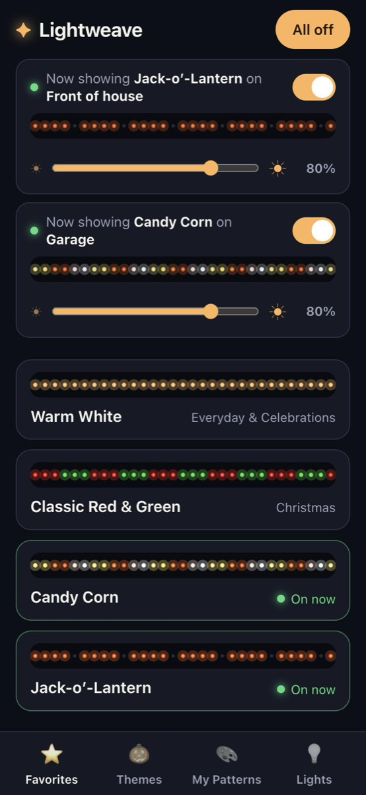
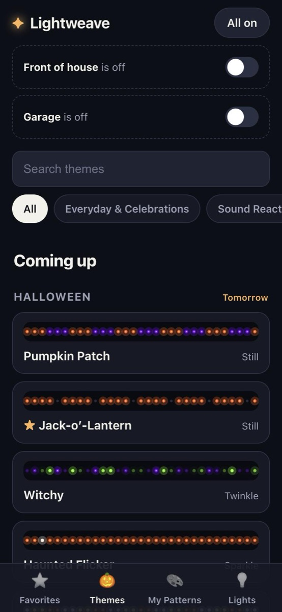
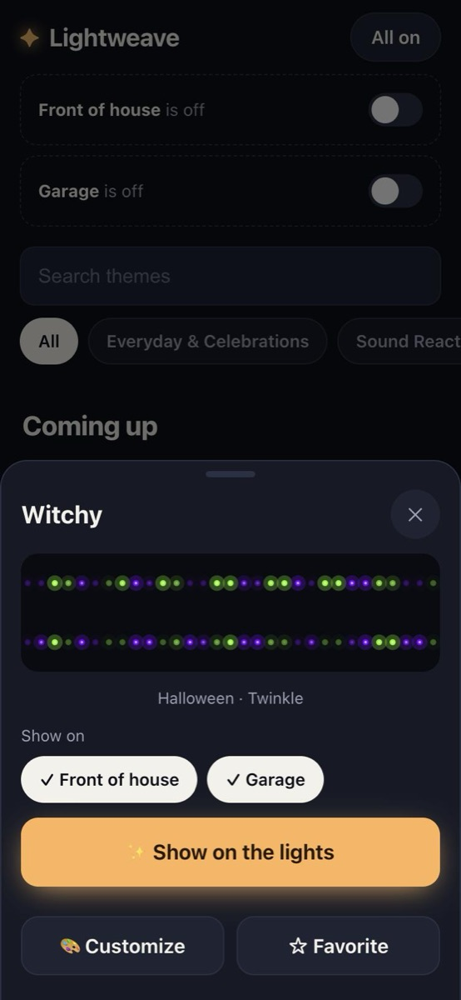
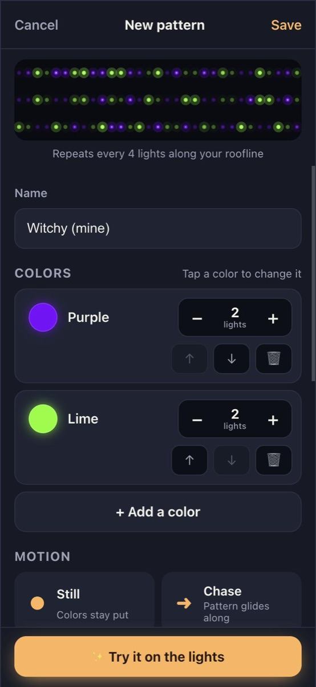
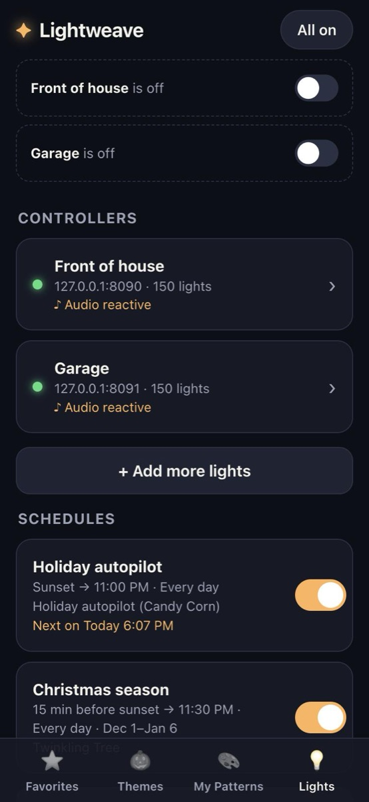
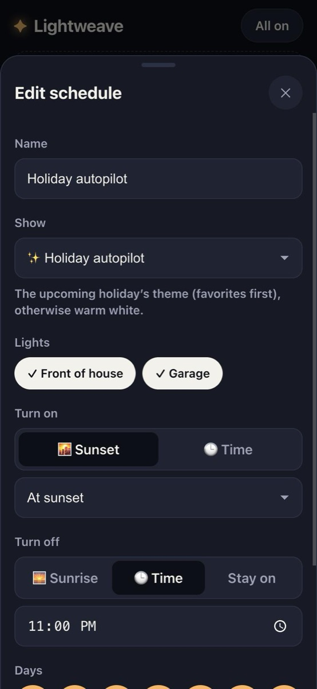

# Lightweave

A phone-friendly companion app for [WLED](https://kno.wled.ge) exterior lights. It brings back the parts of apps like Gemstone that WLED lacks: a library of holiday themes, and a simple editor for building your own patterns ("3 orange, 2 purple, 1 off, repeat") with motion like chase, twinkle and breathe.

## Why I built this

I built this app for my wife after I switched my Gemstone controller over to WLED. Her biggest complaint was that she no longer had any presets for specific holidays, and making custom light patterns in WLED is a big PITA.

So Lightweave is a companion app for WLED, for the husbands and wives who just want an intuitive UI so they can enjoy their lights, while you take satisfaction in the nerdiness of home automation.

<table>
  <tr>
    <td align="center"><br><sub><b>Favorites</b>: what's on, and one tap to change it</sub></td>
    <td align="center"><br><sub><b>Themes</b>: the next holiday comes first</sub></td>
    <td align="center"><br><sub>Pick the lights, tap <b>Show on the lights</b></sub></td>
  </tr>
  <tr>
    <td align="center"><br><sub><b>Editor</b>: colors, counts and motion</sub></td>
    <td align="center"><br><sub><b>Lights</b>: controllers and schedules</sub></td>
    <td align="center"><br><sub><b>Schedules</b>: on at sunset, holiday autopilot</sub></td>
  </tr>
</table>

## Run it

With Docker:

```bash
docker compose up -d --build
```

Then open `http://<server-ip>:8787` on your phone. On iPhone, use **Share → Add to Home Screen** so it opens like an app.

For development:

```bash
npm install
npm run mock        # fake WLED controller on 127.0.0.1:8090 (UDP 4048)
npm run dev         # API on :8787, web app with hot reload on :5173
```

## Run it inside Home Assistant (HAOS)

Lightweave runs as a Home Assistant app (formerly "add-on"): it shows up in the sidebar, opens inside Home Assistant and the Companion app behind Home Assistant's login, and can add the WLED controllers Home Assistant already knows about.

### Install from the app repository

This GitHub repository is also a Home Assistant app repository (`repository.yaml` at the root, the app in `homeassistant/lightweave/`). In Home Assistant:

1. **Settings → Apps → Install app → ⋮ → Repositories**, add `https://github.com/hyhenry/lightweave`, and close the dialog.
2. Find **Lightweave** in the app store, install it, and turn on **Show in sidebar**.

Home Assistant downloads the ready-made image (Raspberry Pi or PC); nothing is built on the device.

### Inside Home Assistant

- **Lights → From Home Assistant** lists WLED controllers set up in Home Assistant's WLED integration; tap **Add** or **Add all**.
- Sunrise and sunset use Home Assistant's home location, and schedules use its time zone.
- Run Lightweave in one place only. Two copies would both stream to the lights and both run schedules.

## How it drives the lights

- **Still patterns** go to WLED once through the JSON API (`seg.i` per-LED colors on segment 0). After that the server isn't needed. WLED doesn't keep these across a power cycle, so after a power loss the controller comes back to its own last preset.
- **Animated patterns** are rendered by Lightweave and streamed to WLED at 30 fps over DDP (UDP port 4048). The same renderer draws the previews in the app, so what you see is what goes on the house. This means **the container has to keep running for animations**. If it stops, WLED returns to its own state after its realtime timeout (2.5s by default). Animations pick back up when the container restarts.
- **Return to WLED** (Lights tab) stops everything Lightweave is doing so the normal WLED app takes over again.

Tips:
- Add controllers by IP address, not `wled-xxxx.local`, and give each one a fixed IP (a DHCP reservation in your router).
- WLED's own timers and schedules don't know about Lightweave. A timer that applies a preset will paint over a still pattern, and a timer that turns the lights off won't stop an animation Lightweave is streaming. Turn lights on and off from Lightweave, or disable WLED timers that clash.
- If WLED splits your strip into several segments, Lightweave's still patterns only paint segment 0. Streaming covers every LED.
- On a strip wired from the "wrong" end, turn on **Run patterns the other way** for that controller.

## Layout

```
shared/        used by both server and browser: types, the render engine, themes,
               holidays, sunrise/sunset, schedule timing, sound effects
server/
  index.ts     entry point (web server + background jobs)
  app.ts       Fastify app; routes/ has one file per area
  player.ts    shows patterns: still (JSON API), animated (DDP stream), sound (WLED effect)
  scheduler.ts runs schedules; devices.ts has status, LED-count sync, sound passthrough
  store.ts     JSON file in $DATA_DIR; migrate.ts upgrades older data
  wled/        WLED protocols: client (HTTP), show, audio, ddp
web/src/
  App.tsx      tabs and sheets; hooks/ loads data; lib/ has pure helpers
  pages/       Favorites, Gallery (Themes), MyPatterns, editor/, lights/, schedules/
  components/  shared UI (cards, Now Showing, previews, sheets)
homeassistant/ the Home Assistant app definition (config, docs, icons)
.github/       CI (tests on every push) and Publish (image on each release)
test/          node:test suites; support/ has fake WLED/Home Assistant and a server launcher
scripts/       `npm run mock` fake WLED; `npm run release`; `npm run build:ha`
```

## Tests

```bash
npm test
```

Uses Node's built-in test runner, no extra dependencies. The API tests start the real server with a throwaway data folder and fake WLED controllers on random ports, so they never touch `./data` or real lights. Tests run in `America/Edmonton` time so sunset times are predictable.

Publishing a new version of the Home Assistant app is covered in [docs/RELEASING.md](docs/RELEASING.md).

## Schedules

Schedules (Lights tab) turn lights on at a set time or at sunset, and off at a set time, at sunrise, or not at all, on chosen days and optionally only part of the year. **Holiday autopilot** shows the upcoming holiday's theme (a favorited one first) and warm white otherwise. Schedules run on the server, so the app doesn't need to be open. Times use the server's time zone (`TZ` in `docker-compose.yml`), and sunset times use the city picked in the app.

Data lives in `$DATA_DIR/lightweave.json` (`/data` in Docker).
